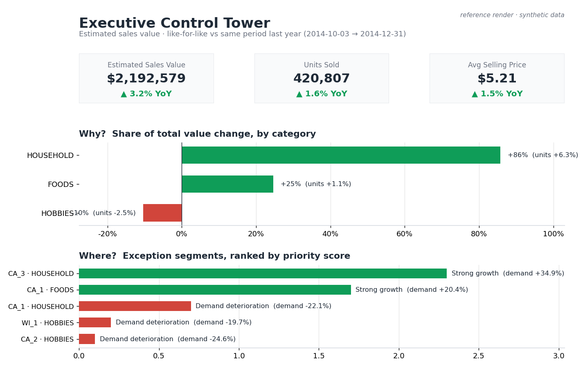

# Retail Commercial Intelligence & Decision System

Turning 5+ years of messy, low-level retail operations data into a **governed
analytical model** and a **3-page executive decision system** — from raw CSVs to
"where should management look this week?"

Built on the [M5 Walmart dataset](https://www.kaggle.com/c/m5-forecasting-accuracy/data):
daily unit sales, weekly prices, and a calendar of events/SNAP days across 3
states, 10 stores, and the full product hierarchy (30,490 item-store series in
the real data).

**▶ [Open the live dashboard](https://shavkatjony.github.io/retail-commercial-intelligence/dashboard/)** — the
self-contained HTML edition, 3 pages, runs in any browser.



> *Reference render from the pipeline's own outputs. The dashboard is built in
> Tableau Public — see [the build guide](dashboard/tableau_build_guide.md).*

> ### ⚠️ On the data
> This repo ships a **synthetic, M5-shaped sample generator** so the entire
> pipeline runs end-to-end in ~10s with zero downloads. The **mechanics are real;
> the numbers below are illustrative, not a business finding.** To produce real
> findings: drop the Kaggle M5 files into `data/raw/`, set `mode: real` in
> `config.yaml`, and `make all && make notebooks` — nothing else changes.

---

## 1 · Executive summary

A regional retailer needs to know **where demand is growing or deteriorating,
which products and stores are driving the change, how price moves relate to
demand, and where to focus attention.** This project builds the data model and
the decision surface to answer exactly that — and, crucially, ranks findings so
the output is a **triage list, not a wall of charts.**

## 2 · Business context

- **Stakeholder:** commercial / category management leadership.
- **Question:** "What changed in the business, why, and what do we do about it?"
- **Scope:** descriptive & diagnostic analytics (what happened and why) —
  deliberately **not** forecasting. The value here is a trustworthy model and
  sharp diagnosis, which is a distinct, complete piece of work.

## 3 · Decisions this system supports

1. Where to protect/expand (segments growing with healthy price).
2. Where to intervene (segments deteriorating, ranked by business impact).
3. Which pricing moves to revisit (price up **and** volume down).
4. How exposed the business is to a few products/stores (concentration).

## 4 · Data architecture

```
Raw M5 CSVs ─▶ Python (reshape wide→long, type, validate) ─▶ Parquet staging
           ─▶ DuckDB SQL (staging → dimensions → facts → marts)
           ─▶ Python metrics (growth · contribution · exceptions)
           ─▶ Tableau Public (3-page decision system)
```

Full diagrams and the **stack rationale** (why DuckDB, why Parquet, why Tableau)
are in [docs/architecture.md](docs/architecture.md).

**Built for the real size, measured at it.** Stress-tested at full M5 shape
(30,450 series × 1,941 days = **59.1M rows**): end-to-end in **84 s at 2.6 GB
peak memory**. The first version needed 8.8 GB. Streaming the reshape,
categorical encoding, process isolation, and a profiled DuckDB memory cap closed
the gap, so the real-data build fits on an 8 GB laptop.
[How each change was measured →](docs/architecture.md#scale--measured-at-real-m5-size)

## 5 · Data model (star schema)

A textbook star, with the **grain stated explicitly** for every table:

- `fact_daily_sales` — **one row = one item × one store × one date.**
- `fact_weekly_price` — one row = one item × one store × one week.
- `dim_date` (event modeled as a date attribute, by design), `dim_product`,
  `dim_store`.

Every table, column, key, and modeling decision is in
[docs/data_dictionary.md](docs/data_dictionary.md).

## 6 · KPI definitions

Six executive metrics — **Estimated Sales Value**, Units Sold, ASP, and their
YoY growth, plus **At-Risk Value**. All growth is **like-for-like** (same window
one year earlier). A deliberate honesty choice: `units × price` is **Estimated
Sales Value, not accounting revenue** (M5 has no refunds/tax/COGS). Exact
formulas: [docs/metric_definitions.md](docs/metric_definitions.md).

## 7 · Analytical methodology

- **Growth** — current period vs. same period last year.
- **Contribution** — decompose the top-line change; a small category can dominate
  the *movement* (in the sample, HOUSEHOLD drives ~86% of the value change).
- **Price–demand** — reported as **association, never causation**
  ("units −22% *alongside* a +9% price rise").
- **Exception engine** — every store×category gets at most one signal
  (growth / deterioration / price-risk) and a transparent
  **priority score = Impact × Magnitude × Confidence**, then High/Med/Low banding.
- **Concentration** — scale-free (adaptive top-k share **and** HHI).

## 8 · Key findings *(illustrative — synthetic data)*

1. Sales value **+3.2% YoY** on **+1.6%** units and **+1.5%** ASP — growth is
   part volume, part price.
2. **HOUSEHOLD** contributes **~86%** of the value change despite being a smaller
   category — the growth engine is concentrated, not broad.
3. The exception engine flags **CA_1 HOUSEHOLD** (−22% demand) and two HOBBIES
   segments as deteriorating, while **CA_3 HOUSEHOLD** (+35%) leads growth.
4. A **price-risk watch list** surfaces items that raised price and lost volume
   (e.g. `HOUSEHOLD_2_001` in WI_2: **+9% price, −41% units**).

*(Rewrite this section from the real-data run before presenting the portfolio.)*

## 9 · Business implications

Protect the concentrated growth engine (supply + shelf space) before anything
else; investigate the top deteriorating segments first (largest impact); and put
the price-risk list in front of the pricing team as a deliberate margin-vs-volume
decision. Full reasoning in
[notebooks/03_business_findings.ipynb](notebooks/03_business_findings.ipynb).

## 10 · Dashboard

Three linked pages — **Executive Control Tower** → **Commercial Diagnostics** →
**Opportunity & Risk** — delivered two ways from the *same* pipeline outputs:

**Primary — Tableau Public** (the BI deliverable)
- Build spec: [dashboard/tableau_build_guide.md](dashboard/tableau_build_guide.md)
- Live link: _add your Tableau Public URL here after publishing_
- Screenshots: `dashboard/screenshots/` _(add after publishing)_

**Companion — self-contained HTML** ([dashboard/index.html](dashboard/index.html))
- **Live:** [shavkatjony.github.io/retail-commercial-intelligence/dashboard/](https://shavkatjony.github.io/retail-commercial-intelligence/dashboard/)

A single portable file (no dependencies, no server) with the same 3 pages, inline
SVG charts, light/dark, and its data refreshed by the pipeline (`make html`).
Editing guide: [dashboard/html_dashboard_guide.md](dashboard/html_dashboard_guide.md).

## 11 · Technical architecture & analysis

| Notebook | What it shows |
| --- | --- |
| [01 · Data Profiling](notebooks/01_data_profiling.ipynb) | Shape, hierarchy, intermittency, data quality |
| [02 · Demand Analysis](notebooks/02_demand_analysis.ipynb) | Trend, seasonality, event & SNAP effects, price–demand |
| [03 · Business Findings](notebooks/03_business_findings.ipynb) | KPIs → contribution → exceptions → implications |

Stack: **Python (pandas)** · **DuckDB SQL** · **Tableau Public** · Make + YAML
config. Data quality is a build gate — see the auto-generated
[docs/data_quality_report.md](docs/data_quality_report.md).

## 12 · Reproducibility

```bash
python -m pip install -r requirements.txt
make all        # generates the sample if needed, then builds everything
```

Run inside the environment where you installed the requirements (this project was
built on Anaconda). If `python` on your PATH isn't that env:
`make all PY=/opt/anaconda3/bin/python`.

Then open the notebooks, or build the dashboard from the guide. To run on real
data: put the three Kaggle M5 CSVs in `data/raw/`, set `data_source.mode: real`
in `config.yaml`, then run `make all && make notebooks`. That one pass rebuilds
the model, both dashboards' data, the README hero figure, and every notebook.

```
retail-commercial-intelligence/
├── config.yaml            # paths, data-source switch, every threshold
├── Makefile               # make all  →  full rebuild
├── src/                   # generate · ingest · validate · metrics · build · html · figures
├── sql/                   # 01 staging → 05 marts (runnable DuckDB SQL)
├── notebooks/             # profiling · demand · findings (executed)
├── dashboard/             # index.html (self-contained) · Tableau guide · extracts
├── docs/                  # data dictionary · metric defs · architecture · DQ report
└── data/                  # raw (gitignored) · processed (gitignored)
```

---

*Design restraint is intentional: no forecasting model, no cloud warehouse, no
second BI tool. The signal is **raw data → governed model → ranked decision**,
executed cleanly by one person.*
