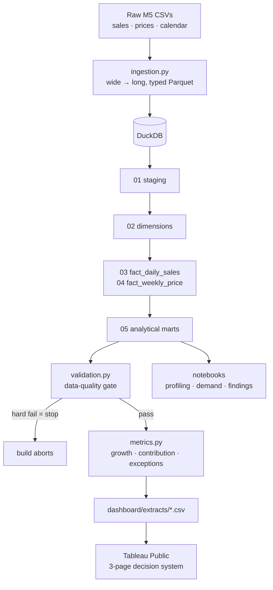
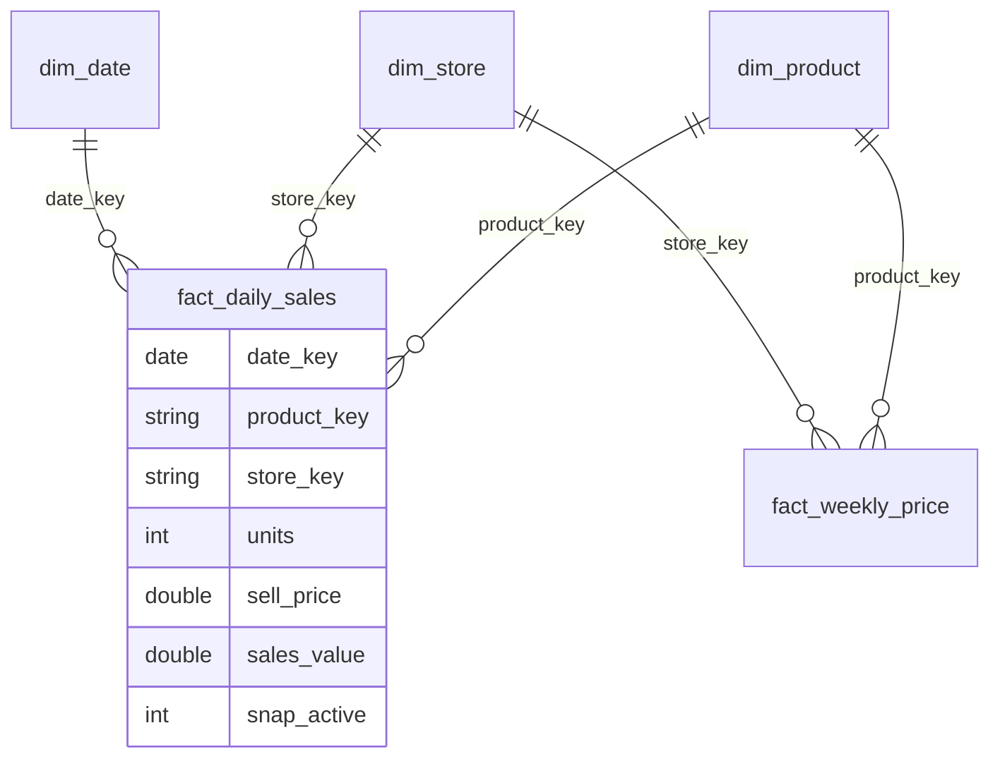

# Technical Architecture

## Pipeline

One command runs all of it: `make all` → `src/build.py`.

## Data model (star schema)

Grain of `fact_daily_sales`: **one row = one item, in one store, on one date.**

## Stack — and why each piece

| Layer | Choice | Why this, not the obvious alternative |
| --- | --- | --- |
| Reshape / validate | **Python + pandas** | Melting wide→long and DQ logic are expressive in pandas; streamed by store with categoricals so 59M rows fit in ~2 GB (see Scale) |
| Staging format | **Parquet** | Columnar, typed, ~10× smaller than CSV; DuckDB reads it zero-copy |
| Transform / model | **DuckDB SQL** | An OLAP engine that runs the *real* `sql/*.sql` with **no server to install** — right-sized for laptop-scale analytics vs. spinning up Postgres/Snowflake |
| Metrics | **Python** | Period-over-period and exception scoring are parametric and testable |
| BI / decision layer | **Tableau Public** | Free, Mac-native, and publishes a **live shareable link**; the semantic model maps cleanly from the star schema |
| Reproducibility | **Makefile + config.yaml** | `make all` rebuilds from scratch; every parameter lives in one file |

## Scale — measured at real M5 size

The sample is small, so the pipeline was also stress-tested on a generated
dataset with the **real M5 shape**: 30,450 series × 1,941 days (2011-01-29 →
2016-05-22) = **59.1M item-store-days**, a 117 MB wide sales file and 8.5M
weekly price rows. Measured end-to-end (`src/build.py`, Intel i9-9980HK MacBook Pro):

| Version | Wall time | Peak memory |
| --- | ---: | ---: |
| First version — one-shot pandas melt, uncapped DuckDB | 105 s | **8.8 GB** |
| Final — the four changes below | 84 s | **2.6 GB** |

What changed, each measured in isolation:

1. **Stream the reshape by store** — melt ~5.9M rows at a time into one Parquet
   writer instead of materializing 59M rows.
2. **Categoricals for every text column** — 2-byte codes instead of Python
   strings. Ingestion alone: 4.9 GB → 1.8 GB, and 83 s → 45 s.
3. **Isolate ingestion in its own process** — its heap returns to the OS before
   DuckDB starts, so the peak is the largest stage, not the sum of stages.
4. **Cap DuckDB at 1.5 GB** (`config.yaml → engine`) — it spills to disk past the
   cap. Profiling showed the culprit was the full-key duplicate-grain check (a
   59M-group aggregate); 1.5 GB vs 3 GB cost no wall time at all.

Result: the real-data build fits on an 8 GB laptop. Outputs stay Tableau-sized:
the largest export is ~2M rows (`mart_monthly_item`), under Tableau Public's
15M-row limit.

## Design restraint (what was deliberately left out)

No forecasting model, no cloud warehouse, no orchestration framework (Airflow),
no second BI tool. Each would add surface area without strengthening the core
signal — *"I can take raw operational data to a governed model to a decision."*
The sophistication is in **selection, architecture, and reasoning**, not tool
count.

## Switching to real data

Set `data_source.mode: real` in `config.yaml`, drop the three Kaggle M5 CSVs
into `data/raw/`, and run `make all && make notebooks`. Nothing else changes —
the schema is identical, so the SQL, validation, metrics, notebooks, HTML
dashboard, README hero figure, and Tableau extracts all regenerate from it.
